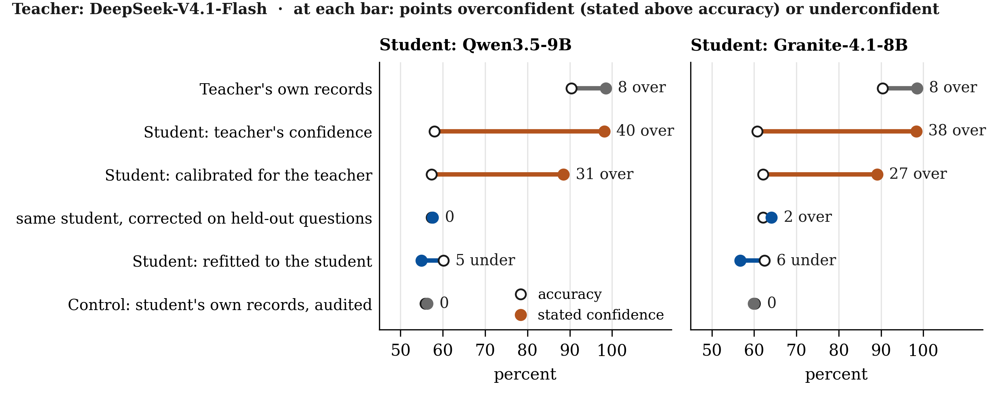

# Inherited Overconfidence

**When a model is trained on another model's answers, how much of the teacher's overconfidence does it inherit, and how much checked data does it take to remove it?**

Entry for the Apart Research AI x Epistemics Sprint (13-15 Nov 2026), Track 1 and Track 2. Author: Martin Kaiser.

Paper: [`paper/paper.pdf`](paper/paper.pdf) · Frozen protocol and deviation log: [`PROTOCOL.md`](PROTOCOL.md) · Every number: [`paper/numbers.tex`](paper/numbers.tex)

## Result

**A small model fine-tuned on a larger model's answers states the confidence written in its training records at its own accuracy. Calibrating the teacher does not fix this; fitting the confidence to the student largely does.**

Teacher: DeepSeek-V4.1-Flash (90% accurate on the 2,000 record questions). Students: fresh LoRA adapters on Qwen3.5-9B and Granite-4.1-8B. Every student saw the same answers; only the confidence number in the records differs. *Gap* = stated confidence minus accuracy in points, on 1,000 held-out TriviaQA questions (sampled answer, seed 1).

| Confidence written into the records | Qwen3.5-9B gap | Granite-4.1-8B gap |
|---|---|---|
| The teacher's own | +40 | +38 |
| Calibrated for the teacher | +31 | +27 |
| Same, labels shuffled across records | +33 | +28 |
| Refitted to the student's correctness | -5 | -6 |
| Calibrated for the teacher, then corrected on 2,000 held-out questions | +0.3 | +2.0 |
| Control: the student's own records, audited | +0.4 | -0.2 |

Student accuracy rose by about 3 of the 32 points that separate students from the teacher (greedy answer, +3.8 and +3.1 against the control). The labels still carry which questions are hard: AUROC of the student's confidence for its own correctness 0.72 and 0.73, against 0.54 and 0.49 with the same labels shuffled across records (controls: 0.67, 0.64). With a teacher of the students' own accuracy (Qwen3.8-27B, thinking off, 60%), calibrated records left +3 and +2. Models, cells, numeric predictions and refutation conditions were committed before the first teacher record (`PROTOCOL.md`, entries of 15 Nov 11:15 to 11:43); all predictions held under the rule scorer (a second grader puts the refitted students at -7.4 and -7.9, outside the registered 7 points); the gap sizes follow from label copying by arithmetic. The arm was added after the protocol's stopping time and is exploratory by its own rule. Reproduce: `python3 loopgain/distill.py report` (from `results/runs_dist_*.json`).



### Supporting experiments (three older 7-8B models): why this happens

Qwen2.5-7B, Llama-3.1-8B and Qwen3-8B with thinking off (LoRA), 1,000 held-out TriviaQA questions. A *teacher* is a model fine-tuned to a known level of overconfidence; a *student* is a fresh adapter on the untouched base model, trained on 2,000 of the teacher's question-answer records. *Gap* = stated confidence minus accuracy, in points. *Gain* = slope of student gap on teacher gap: 1 = all of it arrives, 0 = none. Counts, intervals and every table are in the paper; every number is generated from `results/` by `paper/make_numbers.py`.

| Share of audited records (Qwen teacher and student) | Gain, greedy answer | Gain, sampled answer |
|---|---|---|
| 0% | 1.03 | 1.03 |
| 25% | 0.99 | 0.79 |
| 50% | 0.42 | 0.50 |
| 75% | 0.07 | 0.26 |
| 10%, audited records tagged, asked under the tag | 0.11 | |
| 10%, meaningless tag (K/Q), asked under K | 0.07 | |
| 10%, trained without tags, asked under "verified" | 0.98 | |

1. **A student reproduces the confidence of its training records.** Slope of student gap on record gap 1.03 (Qwen2.5, Llama) and 0.97 (Qwen3); four-generation chains stay near their start, also when every generation answers new questions.
2. **Unmarked audits: sampling shows the mixture, greedy decoding its majority.** In sampled answers the weight of audit-style confidence values equals the audit share; in greedy answers it is 0.07 at 25% audits and 0.89 at 60%.
3. **A tag selects the audited style.** One line on audited records makes a 10% share count; a meaningless tag works as well, the word alone does nothing. Records that carry the tag without an audit dilute it: forged tags on 5, 10 and 20% of records raise the gain under the tag from 0.11 to 0.29, 0.68 and 0.83.
4. **Confidence crosses models, calibration does not.** Qwen students of Llama teachers state their teachers' confidence at 12 points lower accuracy and sit about 11 points above them; auditing 75% of the records leaves gaps of +6 to +17.

Not shown: other traits, pre-training, larger models, imperfect audits. Intervals reflect question sampling with models fixed. Most arms were added after first results; `PROTOCOL.md` lists each with the prediction written before it ran.


## Reproduce

Analysis from the published results (no GPU, about a minute):

```bash
pip install numpy matplotlib
python3 loopgain/analyze.py          # results/runs.json -> results/summary.json, cells.csv
python3 paper/make_numbers.py        # -> paper/numbers.tex (every number in the paper)
python3 paper/figures.py             # -> paper/fig*.pdf, prints every plotted value
python3 -m pytest -q loopgain/tests  # CPU tests of scoring, audit mixing, metrics, grid
```

Training from scratch (Modal account, about $35 of L40S time for the Qwen grid; add `--fam llama31` and `LG_GPU=A100-80GB` for Llama, about $19-24; `--fam qwen3` with `LG_TF=4.51 LG_GPU=A100-80GB` for Qwen3, about $12, then `bash orchestrate.sh qwen3` and `qwen3students`):

```bash
cd loopgain
modal run modal_app.py --stage data                 # TriviaQA splits
modal run modal_app.py --stage base                 # base model pass, teacher datasets
modal run modal_app.py --stage teachers --dry-run   # CPU check of every cell, then without --dry-run
modal run --detach modal_app.py --stage es,seeds,tag,greedy --spawn
bash orchestrate.sh qwen                            # chain generations 2-4
modal run --detach modal_app.py --stage tagctl --spawn   # tag controls
modal run --detach modal_app.py --stage forge --spawn    # forged tags
modal run --detach modal_app.py --stage xllama31 --spawn # Qwen students of Llama teachers (needs the Llama family)
LG_GPU=A100-80GB modal run --detach modal_app.py --stage xqwen25 --fam llama31 --spawn
modal run modal_app.py --stage fresh && bash orchestrate.sh fq   # chains on new questions
modal run modal_app.py --stage pull && modal run modal_app.py --stage raw
```

`paper/build.sh` rebuilds the report in the Apart template (needs pandoc and LibreOffice).

## Layout

| Path | What |
|---|---|
| `PROTOCOL.md` | question, factor table, predictions, analysis rules; frozen before the first model output; deviations logged with time and reason |
| `loopgain/core.py` | prompts, parser, scorer, teacher labels, audit mixing, metrics (no third-party imports) |
| `loopgain/config.py` | the grid: every cell compared in the paper |
| `loopgain/gpu.py`, `modal_app.py` | LoRA training, generation, evaluation; dry run, skip-existing, detached launch |
| `loopgain/analyze.py` | inclusion rule, return-map fits with paired bootstrap, chains, seed noise |
| `loopgain/panel.py` | hosted-model panel on Nebius Token Factory |
| `loopgain/scoring_audit.py` | rule-based scorer against an LLM grader |
| `results/` | per-question evaluation records (`runs*.json`), raw replies, question splits, audit order and every generation's records (`raw_*.tar.gz`), panel replies, summaries |
| `paper/` | report source, figure and number scripts |

## Licences and third-party material

- **Qwen2.5-7B-Instruct**: Apache-2.0 ([model card](https://huggingface.co/Qwen/Qwen2.5-7B-Instruct)).
- **Llama-3.1-8B-Instruct**: [Llama 3.1 Community License](https://github.com/meta-llama/llama-models/blob/main/models/llama3_1/LICENSE). Built with Llama. This repository contains model replies and scores only; no Llama weights or adapters are distributed, and no model trained here is released.
- **TriviaQA** (Joshi et al., 2017): the question texts and answer aliases in `results/` come from TriviaQA and are included so that the results can be reproduced. The dataset card lists its licence as unknown and notes that the University of Washington does not own the copyright of the questions; they remain the property of their original authors.
- **Hosted-model panel**: descriptive numbers under one prompt and one provider's serving setup, not a ranking of the models or the service.

## Prior work

All experiment code was written during the sprint. `paper/tools/prep_docx_tex.py` and `paper/tools/build_template.py` (LaTeX to Apart template) are reused from the author's Swarm Alignment sprint entry.

## AI use

An AI assistant (Claude, in Claude Code) proposed the ideas, wrote the protocol, code and analysis, ran the experiments and drafted the report. Martin Kaiser chose the idea and the trait, set the budget and reviewed design and results.

## Acknowledgements

All compute and API use ran on free credits: [Modal](https://modal.com) (GPU training and evaluation), [Nebius](https://nebius.com) Token Factory (hosted-model panel and the Qwen3-235B scorer check; credits offered to Apart Research sprint participants), [Anthropic](https://www.anthropic.com) (Claude Haiku 5.5 scorer check; Claude Code as research assistant) and [OpenAI](https://openai.com) (Codex reviews). Models and TriviaQA come from [Hugging Face](https://huggingface.co). Thanks to [Apart Research](https://apartresearch.com) for the sprint.
