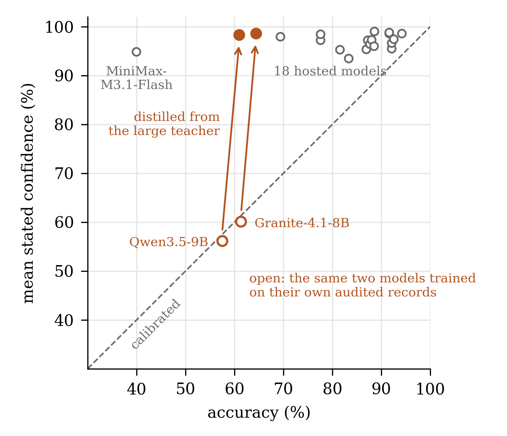
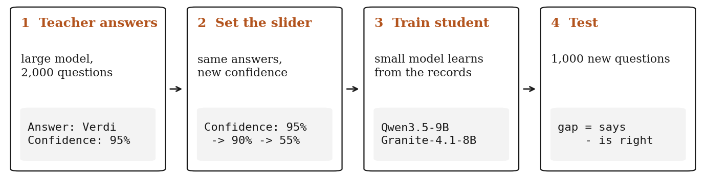
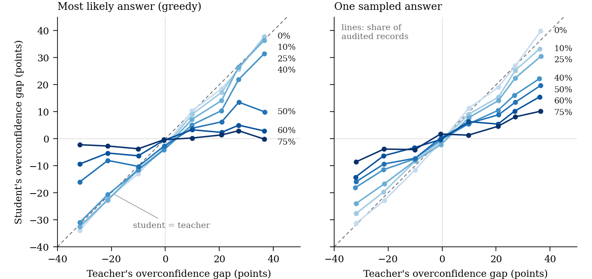

# A Confidence Slider for Small LLMs: The Dunning–Kruger Risk by Inheritance

**When a model is trained on another model's answers, how much of the teacher's overconfidence does it inherit, and how much checked data does it take to remove it?**

Entry for the Apart Research AI x Epistemics Sprint (13-15 Nov 2026), Track 1 and Track 2. Author: Martin Kaiser.

Paper: [`paper/paper.pdf`](paper/paper.pdf) · Frozen protocol and deviation log: [`PROTOCOL.md`](PROTOCOL.md) · Every number: [`paper/numbers.tex`](paper/numbers.tex)

## Result

**Three results from fine-tuning two small AI models on a larger model's answers, changing only the confidence written in the training records:**

1. **Confidence can be set without changing knowledge.** The students stated the confidence of their records (within 2.5 points) while their accuracy stayed the same at every setting.
2. **The right setting belongs to the student, not the teacher.** The teacher's confidence left the students overconfident, even after the teacher was calibrated; set against the student's own accuracy, most of the gap went away.
3. **The teacher's calibrated confidence can teach which questions are hard.** On trivia it did, and that ability disappeared when the same numbers were shuffled across questions. Answering only the more confident half of the questions, the students were right on 75% and 80% of them, against 60% and 62% with shuffled labels (post hoc). Two further training seeds, registered first, gave the same picture (AUROC difference to the shuffled student +0.18 to +0.25 in all six pairs; `python3 loopgain/rep.py`). On multiple-choice questions the ranking did not transfer.

Two extensions (exploratory, predictions registered first): with the confidence written as one of six phrases instead of a number the result was the same (calibrated teacher +32 and +28, fitted to the student -2 and -2). On 1,000 Natural Questions the slider and the ranking held, but no setting was honest: students fitted on trivia were still about 20 points overconfident.

Three further arms, added on 16 November (exploratory; predictions and outcomes with timestamps in `PROTOCOL.md`):

- **Other ways of asking.** The trained level is not tied to the trained reply template. Asked in other words and another format, students of the calibrated teacher and students fitted to themselves stayed 35 and 33 points apart in stated confidence (trained format: 34 and 32); asked in a separate second turn, 32 and 43. 15 of 18 predictions held; missed: the answer-only prompt cost up to 11 points of accuracy, and for Granite the second-turn difference was larger, not smaller.
- **How many checked answers the fix needs.** With 250 checked student answers the fitted label's mean was within 5 points of the untrained student's accuracy in 90% and 91% of random draws (50 answers: 57% and 56%). Students trained on one draw of 250 had gaps of -1 and -7. The ranking did not depend on the number checked.
- **Multiple-choice questions (MMLU-Pro, our own partition).** The slider held for both students (stated confidence within 1 point of every label). A calibrated teacher left gaps of +25 (Qwen3.5-9B) and +37 (Granite-4.1-8B). The label fitted to the untrained student left -9 for Granite and -18 for Qwen, outside the registered limit of 15: the trained Qwen student was 65% right, the label had been fitted at 48%. The ranking did not transfer (AUROC 0.55 and 0.53 against 0.52 and 0.52 shuffled; predicted at least 0.60). Corrected after training instead (post hoc: fit on 500 test questions, applied to the other 500, and the reverse), the Qwen gap was +0.3 and -0.2 in the two halves; that repairs the level, not the missing ranking. `python3 loopgain/mcrecal.py`. A control registered first (each student trained on its own answers; `python3 loopgain/mcl.py`) kept Granite at the untrained accuracy (43%, gap -0.5), so the teacher's answers moved the accuracy and made the fitted label stale. With 250 checked answers of the trained student the correction left the gap within 5 points in 84% and 82% of draws. 6 of 9 and 8 of 9 predictions held. See `results/mc_stats.json` and Table 20 of the paper; the pilot that first failed its format gate is reported in Appendix C.
- **What a fixed rule sees (post hoc, no new model output).** A rule that acts on an answer only if the model states at least 80% passed 93% and 94% of the answers of the students trained on the calibrated teacher's confidence, and 40% and 35% of the passed answers were wrong. Students with confidence fitted to themselves never stated 80; at 70 the rule passed 55% and 54% of their answers, 25% and 19% of them wrong. `python3 loopgain/thresh.py`, Table 23 of the paper.
- **Repairing the level on other questions (post hoc, no new model output).** On 1,000 Natural Questions every student was overconfident, +20 and +21 even with the label fitted on trivia. A correction fitted on 250 checked answers of those questions and applied to the rest left the gap within 5 points in 81 to 93% of 500 draws (all cells, three corrections) and kept the ranking (AUROC 0.67 before and after for Qwen3.5-9B, 0.70 and 0.69 for Granite-4.1-8B). One expectation missed: the two one-number shifts left a per-level error (ECE) of up to 9 and 10 where at most 8 was expected; the isotonic fit stayed at 4 or below. The same correction fitted on trivia answers left +19 to +35. `loopgain/nqfix.py`, `results/nqfix_stats.json`, Table 25.
- **The slider at chosen levels (registered first, 10 of 10 predictions).** The calibrated labels were shifted to a mean of 50, 65 and 81%. Both students stated within 2.1 points of the label mean (slope 0.99 to 1.01) and their accuracy stayed within 1.5 points of the 90% cell. `loopgain/lvl.py`, `results/lvl_stats.json`, Figure 2a and Figure 9.
- **Certainty in sentences without a number (registered first, mixed: 6 of 10).** With the answers written as neutral, hedged or label-matched sentences, a later numeric question was answered at 96 to 99% whatever the wording had been; the ranking went into the choice of words (answers with "definitely" right 67 and 73% of the time, with "probably" 41 and 46%). `loopgain/prose.py`, `results/prose_stats.json`, Appendix C5.
- Thirteen detail tables of the supporting experiments are in [`paper/appendix-full.pdf`](paper/appendix-full.pdf).

**Why the title.** In the experiment, accuracy stayed almost fixed while the confidence written into the training records set how sure the student sounded: 98% with the large teacher's own confidence, 89% with a calibrated teacher, 55 to 57% with confidence fitted to the student, all at about 60% accuracy. Stated confidence behaves like a slider that whoever writes the records can turn, which is how the overconfidence arises, how it is repaired, and how it could be misused. Side note: the outcome resembles the Dunning-Kruger pattern in people (Kruger and Dunning, 1999), and the 18 hosted models we tested show it too (accuracy from 40 to 94%, stated confidence only from 94 to 99%); the cause differs, since the student's is a copied label.



**The study design.**



**One example.** Asked who wrote the opera *A Masked Ball* (Verdi), a Qwen3.5-9B student answered "Giacomo Puccini": with 99% confidence when trained on the teacher's own confidence, 90% when the teacher's records had first been calibrated, and 40% when the same records carried confidence fitted to the student. Same model, same training answers, same wrong reply; only the numbers in the training records differed. After training on calibrated teacher records, 92% of this student's 389 wrong greedy answers came with at least 85% stated confidence.

**The metric.** Overconfidence gap G = mean stated confidence - accuracy, in points, on a fixed question set. Plus = overconfident, minus = underconfident, target 0. It is the classic overconfidence measure (Lichtenstein & Fischhoff 1977); it belongs to a model on a question set, not to a model alone. For a student trained on a teacher's records with mean confidence label L and accuracy A_T, the gap splits exactly: G_S = (C_S - L) + (L - A_T) + (A_T - A_S) = copying error + overconfidence left in the records + accuracy difference. Calibrating the teacher removes only the middle term. Example (Qwen3.5-9B, teacher's own confidence): +40.1 = -0.3 + 8.1 + 32.3; after calibrating the teacher: +31.2 = -1.4 - 0.4 + 33.1.

**What is new** (as far as we know). Earlier studies of confidence under training on model output use one model as its own teacher. Here (1) the teacher is about 30 points more accurate than the student, with stated confidence in the records; (2) the test is label-only (identical answers, four confidence labellings); (3) the obvious safeguard, calibrating the teacher, is tested and found insufficient, with the decomposition above and a shuffle control.

Teacher: DeepSeek-V4.1-Flash (90% of its 1,978 retained answers correct). Students: fresh LoRA adapters on Qwen3.5-9B and Granite-4.1-8B. Every student saw the same answers; only the confidence number in the records differs. *Gap* = stated confidence minus accuracy in points, on 1,000 held-out TriviaQA questions (sampled answer, seed 1).

| Confidence written into the records | Qwen3.5-9B gap | Granite-4.1-8B gap |
|---|---|---|
| The teacher's own | +40 | +38 |
| Calibrated for the teacher | +31 | +27 |
| Same, labels shuffled across records | +33 | +28 |
| Refitted to the student's correctness | -5 | -6 |
| Calibrated for the teacher, then corrected on 2,000 held-out questions | +0.3 | +2.0 |
| Control: the student's own records, audited | +0.4 | -0.2 |

Student accuracy rose by about 3 of the 32 points that separate students from the teacher (greedy answer, +3.8 and +3.1 against the control). The labels still carry which questions are hard: AUROC of the student's confidence for its own correctness 0.72 and 0.73, against 0.54 and 0.49 with the same labels shuffled across records (controls: 0.67, 0.64). With a teacher of the students' own accuracy (Qwen3.8-27B, thinking off, 60%), calibrated records left +3 and +2. Models, cells, numeric predictions and refutation conditions were committed before the first teacher record (`PROTOCOL.md`, entries of 15 Nov 11:15 to 11:43); all predictions held under the rule scorer (a second grader puts the refitted students at -7.4 and -7.9, outside the registered 7 points); the gap sizes follow from label copying by arithmetic. The arm was added after the protocol's stopping time and is exploratory by its own rule. Reproduce: `python3 loopgain/distill.py report` (from `results/runs_dist_*.json`).


### Supporting experiments (three older 7-8B models): why this happens

Qwen2.5-7B, Llama-3.1-8B and Qwen3-8B with thinking off (LoRA), 1,000 held-out TriviaQA questions. A *teacher* is a model fine-tuned to a known level of overconfidence; a *student* is a fresh adapter on the untouched base model, trained on 2,000 of the teacher's question-answer records. *Gap* = stated confidence minus accuracy, in points. *Gain* = slope of student gap on teacher gap: 1 = all of it arrives, 0 = none. Counts, intervals and every table are in the paper; every number is generated from `results/` by `paper/make_numbers.py`.

| Share of audited records (Qwen teacher and student) | Gain, greedy answer | Gain, sampled answer |
|---|---|---|
| 0% | 1.03 | 1.03 |
| 25% | 0.99 | 0.79 |
| 50% | 0.42 | 0.50 |
| 75% | 0.07 | 0.26 |
| 10%, audited records tagged, asked under the tag | 0.11 | |
| 10%, meaningless tag (K/Q), asked under K | 0.07 | |
| 10%, trained without tags, asked under "verified" | 0.98 | |

1. **A student reproduces the confidence of its training records.** Slope of student gap on record gap 1.03 (Qwen2.5, Llama) and 0.97 (Qwen3); four-generation chains stay near their start, also when every generation answers new questions.
2. **Unmarked audits: sampling shows the mixture, greedy decoding its majority.** In sampled answers the weight of audit-style confidence values equals the audit share; in greedy answers it is 0.07 at 25% audits and 0.89 at 60%.
3. **A tag selects the audited style.** One line on audited records makes a 10% share count; a meaningless tag works as well, the word alone does nothing. Records that carry the tag without an audit dilute it: forged tags on 5, 10 and 20% of records raise the gain under the tag from 0.11 to 0.29, 0.68 and 0.83.
4. **Confidence crosses models, calibration does not.** Qwen students of Llama teachers state their teachers' confidence at 12 points lower accuracy and sit about 11 points above them; auditing 75% of the records leaves gaps of +6 to +17.

Not shown: other traits, pre-training, larger models, imperfect audits. Intervals reflect question sampling with models fixed. Most arms were added after first results; `PROTOCOL.md` lists each with the prediction written before it ran.



## Reproduce

Analysis from the published results (no GPU, about a minute):

```bash
pip install numpy matplotlib
python3 loopgain/analyze.py          # results/runs.json -> results/summary.json, cells.csv
python3 paper/make_numbers.py        # -> paper/numbers.tex (every number in the paper)
python3 paper/figures.py             # -> paper/fig*.pdf, prints every plotted value
python3 -m pytest -q loopgain/tests  # CPU tests of scoring, audit mixing, metrics, grid
```

Training from scratch (Modal account, about $35 of L40S time for the Qwen grid; add `--fam llama31` and `LG_GPU=A100-80GB` for Llama, about $19-24; `--fam qwen3` with `LG_TF=4.51 LG_GPU=A100-80GB` for Qwen3, about $12, then `bash orchestrate.sh qwen3` and `qwen3students`):

```bash
cd loopgain
modal run modal_app.py --stage data                 # TriviaQA splits
modal run modal_app.py --stage base                 # base model pass, teacher datasets
modal run modal_app.py --stage teachers --dry-run   # CPU check of every cell, then without --dry-run
modal run --detach modal_app.py --stage es,seeds,tag,greedy --spawn
bash orchestrate.sh qwen                            # chain generations 2-4
modal run --detach modal_app.py --stage tagctl --spawn   # tag controls
modal run --detach modal_app.py --stage forge --spawn    # forged tags
modal run --detach modal_app.py --stage xllama31 --spawn # Qwen students of Llama teachers (needs the Llama family)
LG_GPU=A100-80GB modal run --detach modal_app.py --stage xqwen25 --fam llama31 --spawn
modal run modal_app.py --stage fresh && bash orchestrate.sh fq   # chains on new questions
modal run modal_app.py --stage pull && modal run modal_app.py --stage raw
```

`paper/build.sh` rebuilds the report in the Apart template (needs pandoc and LibreOffice).

## Layout

| Path | What |
|---|---|
| `PROTOCOL.md` | question, factor table, predictions, analysis rules; frozen before the first model output; deviations logged with time and reason |
| `loopgain/core.py` | prompts, parser, scorer, teacher labels, audit mixing, metrics (no third-party imports) |
| `loopgain/config.py` | the grid: every cell compared in the paper |
| `loopgain/gpu.py`, `modal_app.py` | LoRA training, generation, evaluation; dry run, skip-existing, detached launch |
| `loopgain/analyze.py` | inclusion rule, return-map fits with paired bootstrap, chains, seed noise |
| `loopgain/panel.py` | hosted-model panel on Nebius Token Factory |
| `loopgain/panel_adaption.py` | second-provider check: three panel models repeated on Adaption (exploratory, needs `pip install adaption`) |
| `loopgain/scoring_audit.py` | rule-based scorer against an LLM grader |
| `results/` | per-question evaluation records (`runs*.json`), raw replies, question splits, audit order and every generation's records (`raw_*.tar.gz`), panel replies, summaries |
| `paper/` | report source, figure and number scripts |

## Licences and third-party material

- **This repository**: code under the MIT License; paper text, figures, protocol and result files under CC BY 4.0 (see [`LICENSE`](LICENSE)).
- **Distillation arm models**: DeepSeek-V4.1-Flash (MIT), Qwen3.8-27B, Qwen3.5-9B and Granite-4.1-8B (Apache-2.0). Only replies and scores are distributed; no weights or adapters.

- **Qwen2.5-7B-Instruct**: Apache-2.0 ([model card](https://huggingface.co/Qwen/Qwen2.5-7B-Instruct)).
- **Llama-3.1-8B-Instruct**: [Llama 3.1 Community License](https://github.com/meta-llama/llama-models/blob/main/models/llama3_1/LICENSE). Built with Llama. This repository contains model replies and scores only; no Llama weights or adapters are distributed, and no model trained here is released.
- **TriviaQA** (Joshi et al., 2017): the question texts and answer aliases in `results/` come from TriviaQA and are included so that the results can be reproduced. The dataset card lists its licence as unknown and notes that the University of Washington does not own the copyright of the questions; they remain the property of their original authors.
- **Hosted-model panel**: descriptive numbers under one prompt and one provider's serving setup (three models were repeated on a second provider and their gaps differed by less than 2 points), not a ranking of the models or the service.

## Prior work

All experiment code was written during the sprint. `paper/tools/prep_docx_tex.py` and `paper/tools/build_template.py` (LaTeX to Apart template) are reused from the author's Swarm Alignment sprint entry.

## AI use

An AI assistant (Claude, in Claude Code) proposed the ideas, wrote the protocol, code and analysis, ran the experiments and drafted the report. Martin Kaiser chose the idea and the trait, set the budget and reviewed design and results.

## Acknowledgements

All compute and API use ran on free credits: [Modal](https://modal.com) (GPU training and evaluation), [Nebius](https://nebius.com) Token Factory (hosted-model panel and the Qwen3-235B scorer check; credits offered to Apart Research sprint participants), [Adaption](https://adaptionlabs.ai) (second-provider check of three panel models; credits offered to sprint participants), [Anthropic](https://www.anthropic.com) (Claude Haiku 5.5 scorer check; Claude Code as research assistant) and [OpenAI](https://openai.com) (Codex reviews). Models and TriviaQA come from [Hugging Face](https://huggingface.co). Thanks to [Apart Research](https://apartresearch.com) for the sprint.
